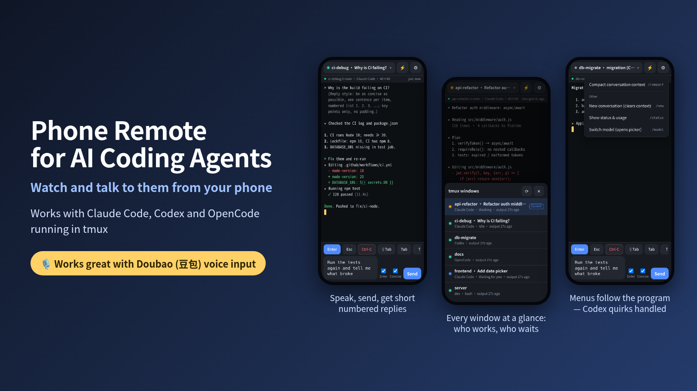
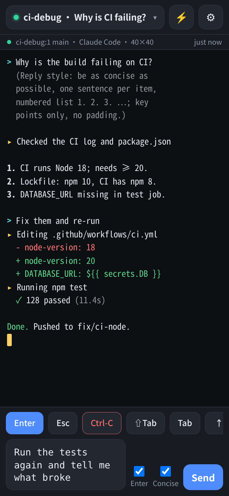
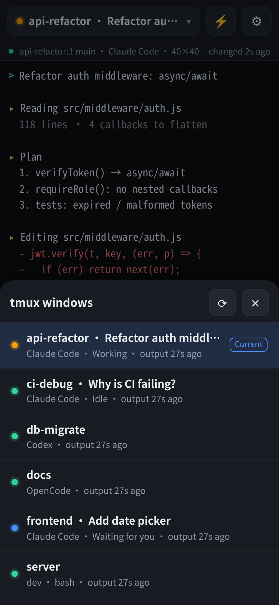
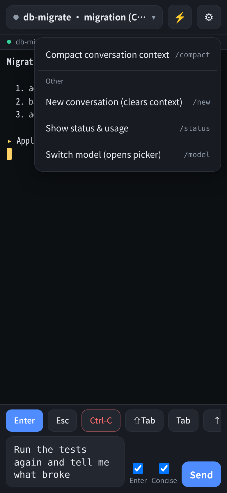

<div align="center">



# Phone Remote for AI Coding Agents

### Watch and talk to your AI coding agents from your phone — by voice

Works with **Claude Code**, **Codex** and **OpenCode** running in tmux, from your phone's browser.<br>
Speak your prompt, tap send, read short numbered answers. **Zero dependencies.**

    

**English** · [简体中文](README.zh-CN.md)

</div>

---

> ### 🎙️ Best with Doubao (豆包) voice input
>
> Phone Remote is deliberately *just a text box*: your phone's keyboard does the speech recognition, so any voice keyboard works — and the one the author drives it with every day is **Doubao Input Method (豆包输入法)**.
> Tap the input box → tap Doubao's mic → say what you want → glance at the text → **Send**. That is the whole workflow, and it feels great.
> [Details and tips →](docs/voice-input.md)

## The problem

You start a long task with an AI coding agent in a tmux window — a refactor, a fix-until-green loop, a migration — and then you have to leave your desk. The agent keeps working. Then it stops to ask *"Do you want to proceed?"* and waits, for hours, because you are in a queue for coffee.

Phone Remote puts that window on your phone. You see what the agent is doing, answer its questions, and give the next instruction — by voice if you like — without an SSH app, a tiny terminal keyboard, or a cloud account.

## Why use it

- 🎙️ **Voice first.** The input box is built to be dictated into: IME-safe Enter, one tap to send, one checkbox to get short answers back. See [Doubao voice input](#-best-with-doubao-豆包-voice-input) above.
- 🤖 **It knows which agent it is talking to.** Claude Code, Codex and OpenCode are recognised per window from the process tree — not from the window name, because what runs in a window changes all day. Labels, quick-command menus and, importantly, *how input is sent* follow the program. (Codex swallows the first Enter after fast-typed text; Phone Remote works around that. [Why](docs/how-it-works.md#why-each-agent-gets-its-own-way-of-being-typed-to).)
- ✂️ **Concise mode.** One checkbox appends a sentence to every prompt that asks for the shortest possible numbered answer. Phone screens are small and so is your patience. The wording was [A/B-tested against real models](#concise-mode).
- 🪶 **Zero dependencies.** Node.js and tmux. No xterm.js, no node-pty, no build step, no relay server, nothing to sign up for. About 2,400 lines of code you can read in an afternoon.
- 🌍 **10 interface languages** — English, 简体中文, 繁體中文, 日本語, 한국어, Español, Français, Deutsch, Português, Русский. Adding one is [a single JSON file](src/web/locales/README.md).
- 🔒 **Locked down by default.** A random access token, an allow-list that only lets private networks in, no cloud, no telemetry. [Security notes](docs/security.md).
- 📶 **Built for flaky mobile networks.** An unchanged screen is answered with a 44-byte reply, bigger replies are gzipped (the page goes from 66 KB to 20 KB), and requests time out and recover instead of freezing after the phone sleeps.
- 📜 **Earlier conversation.** Agents on the terminal's alternate screen have no scrollback; for Claude Code, pull up to load what was said before, read from its own session log.

<table>
  <tr>
    <td width="33%"></td>
    <td width="33%"></td>
    <td width="33%"></td>
  </tr>
  <tr>
    <td align="center"><sub>A dictated sentence waiting to be sent; the answer above came back as a short numbered list</sub></td>
    <td align="center"><sub>Every tmux window: which program, working / waiting for you / idle</sub></td>
    <td align="center"><sub>The ⚡ menu changes with the program (this is a Codex window)</sub></td>
  </tr>
</table>

<sub>The screenshots use a demo setup (stand-in processes printing canned text), made with [`scripts/make-screenshots.mjs`](scripts/make-screenshots.mjs).</sub>

## Quick start

You need **Node.js 18+** and **tmux 3.x** on the computer where your agents run. Linux is what it is developed and tested on; macOS should work (process detection falls back to `ps`) but has not been tried by the author — reports welcome.

```bash
git clone https://github.com/unnamedfish2017/phone-remote-for-ai-coding-agents.git
cd phone-remote-for-ai-coding-agents
node bin/phone-remote.mjs
```

Phone Remote prints a link and a QR code. **Scan it with your phone** — same Wi-Fi, or a VPN such as [Tailscale](https://tailscale.com) (it lists every address your phone could use, and tags VPN ones). Done. The code is drawn twice as big when your terminal has room (`--qr-size`), and the first time you run it on a desktop it also opens a page with a full-size one in your browser (`--open` brings that page back any time).

```text
  Phone Remote for AI Coding Agents 0.1.0
  tmux 3.2a

  Open on your phone:

    http://192.168.1.23:8787/?token=…&lang=en
      ↳ Wi-Fi / LAN · wlan0
    http://100.101.102.103:8787/?token=…&lang=en
      ↳ VPN · tailscale0

  Scan this with your phone's camera (Wi-Fi / LAN · wlan0):

      █▀▀▀▀▀█ ▄█ ▄▄█▄▄█▀▀▀█ ▄▀▄ █▀▀▀▀▀█
      █ ███ █ ▄█▀█ ▄▄█ ▄▀█ ▀█   █ ███ █
      █ ▀▀▀ █ ▄ █ ▀▄▄▄▀▀▀▀▀  ▀  █ ▀▀▀ █
      ▀▀▀▀▀▀▀ ▀ ▀ █ █▄█ ▀▄▀▄█▄▀ ▀▀▀▀▀▀▀
      ███▀█ ▀▀██▀ ▀█▄ ▄█▄█▄▄▀█▄█▄█ ▀ █▄
    ⋮  (the full code is drawn here)
```

Start your agents inside tmux as usual (`tmux new -s api`, then run `claude`, `codex` or `opencode`); every tmux window shows up in the list. Want a `phone-remote` command? Run `npm link` in the folder.

<details>
<summary><b>Options</b> (<code>phone-remote --help</code> shows them all)</summary>

| Option | |
|---|---|
| `--port <n>` | port (default `8787`; `0` = pick a free one) |
| `--host <address>` | address to bind (default `0.0.0.0`) |
| `--token <token>` | use this access token instead of the generated one (`PHONE_REMOTE_TOKEN`) |
| `--allow-from <list>` | who may connect: CIDRs / IPs, default = this machine + private networks + Tailscale range |
| `--cert` / `--key` | serve HTTPS ([how](docs/security.md#https)) |
| `--lang <code>` | language in the printed link (default: from your system locale) |
| `--public-url <url>` | the address your phone should use, if it is not one of this machine's |
| `--qr-size <size>` | QR code size: `auto` (default, twice as big when the terminal has room), `large`, `compact` |
| `--open` / `--no-open` | open a page with a full-size QR code in your browser (default: first run on a desktop, never over SSH) |
| `--socket-name` / `--socket-path` | talk to a non-default tmux server |
| `--no-auth` | no token at all — refused unless the address is loopback |

</details>

## 🎙️ Best with Doubao (豆包) voice input

Voice is the point of putting an agent on your phone: nobody wants to type a paragraph on a glass keyboard.

Phone Remote therefore does **not** attempt speech recognition. The page is a plain text box that is careful about input methods, and your keyboard's own voice typing fills it. The author uses **Doubao Input Method (豆包输入法)** every day:

1. Install Doubao Input Method on your phone and switch to it as the keyboard.
2. Open the page and tap the input box.
3. Tap the 🎙️ key on the keyboard and say what you want the agent to do.
4. Look at the text (fix a word if you need to) and tap **Send**.

Why it fits so well:

- **No microphone permission, no HTTPS needed.** The page never touches the microphone — your keyboard does. Plain HTTP on your LAN or VPN is enough.
- **IME-safe.** Enter is ignored while an input method is composing, so confirming dictated text never sends half a sentence.
- **Concise mode** turns long, chatty spoken prompts into short numbered answers you can read at a glance.
- **Short answers just work.** Replying `1` to an approval dialog sends exactly `1` — concise mode never appends to menu answers, slash commands, or shell lines.

Any other voice keyboard (Gboard, iOS dictation, …) works the same way. More in [docs/voice-input.md](docs/voice-input.md).

## Supported agents

| Program | Recognised | What Phone Remote does for it |
|---|---|---|
| **Claude Code** | ✅ | working / waiting / idle status in the window list, earlier conversation (pull up), `/btw` side questions, model shortcuts |
| **Codex** | ✅ | sends Enter in a way Codex accepts on the first try (see below), `/status`, `/model` |
| **OpenCode** | ✅ | `/status`, `/models` |
| anything else | – | works as a plain terminal window |

Tested with Claude Code 2.1.284, Codex 0.163.0, OpenCode 1.18.33 and tmux 3.2a, on Node.js 18, 20 and 22. Adding another program is a few lines in [`src/agents.mjs`](src/agents.mjs).

## Concise mode

Next to the **Enter** checkbox there is a **Concise** checkbox, on by default. When it is ticked, a sentence like this is appended to what you send:

> *(Reply style: be as concise as possible, one sentence per item, numbered list 1. 2. 3. …; keep only the key points, as many items as there are points, no padding, don't aim for completeness.)*

It is only added where it helps: never to slash commands, `!` shell lines, `#` memory lines, one-character answers like `1` or `y`, or windows that are not Claude Code / Codex / OpenCode (a plain shell would get its command mangled). The sentence is translated for every interface language, and you can edit it in Settings.

The wording is not a matter of taste. It was tested against Claude Haiku 4.5 and Sonnet 5.5 on 8–11 everyday questions (small samples, one run per cell, but the pattern was the same for both models and in both rounds):

| Wording | Replies with *exactly* 4 points | Reply length |
|---|---|---|
| "numbered 1, 2, 3, 4 …" | 7–8 of 11 (even for a yes/no question) | baseline |
| "any number of items" | 0–1 of 8 | ~30 % longer |
| **one sentence each · key points only · don't pad · don't aim for completeness** (shipped) | 1–3 of 11 (a yes/no question gets one item) | same or shorter |

Spelling out "1, 2, 3, 4" makes models pad or cut every answer to four points. More in [src/web/locales/README.md](src/web/locales/README.md).

## Languages

English · 简体中文 · 繁體中文 · 日本語 · 한국어 · Español · Français · Deutsch · Português · Русский

Pick one in **⚙ → 🌐 Language**, or choose *Auto* to follow the phone's language. The link Phone Remote prints already carries your computer's language. New language = one JSON file in [`src/web/locales/`](src/web/locales/) — see the [guide](src/web/locales/README.md); the tests tell you if anything is missing.

## Security — please read

Anyone who can talk to Phone Remote can type into your terminals, which is the same as running commands as you. So:

- A random **access token** is required for every API call (header only — a token in a URL would end up in logs and browser history). It is created on first start in `~/.phone-remote/token` (mode `0600`).
- A **source-IP allow-list** is checked first: by default only this machine, private networks (`10/8`, `172.16/12`, `192.168/16`) and Tailscale's `100.64/10` get in. If your machine has a public address, strangers are refused before they can try a token.
- Without a token (`--no-auth`) it only starts on a loopback address and rejects requests that arrive under a foreign `Host` name (DNS rebinding).
- Writes must be JSON, so a web page you happen to visit cannot post to it.
- Plain HTTP is fine on a trusted LAN or inside an encrypted VPN (Tailscale, WireGuard). On anything else, [use HTTPS](docs/security.md#https).

**Do not expose it to the internet.** Treat the token like an SSH key. Details: [docs/security.md](docs/security.md).

## How it works

```text
  phone browser   ⇄   this server (one Node process)   ⇄   tmux   ⇄   Claude Code / Codex / OpenCode
  a text box, a key bar,   the page polls every 350 ms,         capture-pane  → the screen (colours as SGR)
  a quick menu             the server asks tmux each time;      send-keys     → typing
                           an unchanged screen costs            paste-buffer  → multi-line text
                           a 44-byte reply
```

No pty, no terminal emulator, no WebSocket: the screen is `tmux capture-pane -e`, a few dozen lines of JavaScript turn its colour codes into HTML, and input goes back through `send-keys`. That is why it is small — and why it works with anything that lives in a tmux window. [Longer version →](docs/how-it-works.md)

## Troubleshooting

| Symptom | Try |
|---|---|
| The phone cannot open the link | Same network or VPN? A firewall rule for the port (`sudo ufw allow 8787/tcp`)? `--public-url` if the phone must use another name. |
| `403` / "Your IP address is not allowed" | Your phone's address is outside the default allow-list — add it: `--allow-from 192.168.0.0/16,203.0.113.0/24`. |
| Page loads, then "request timed out" over a VPN or mobile data | Probably a path-MTU black hole. [Diagnosis and a one-line fix](docs/troubleshooting.md#requests-time-out-over-a-vpn-or-mobile-data-but-small-things-work). |
| A window is missing | Phone Remote talks to tmux's default server. For another one: `--socket-name` / `--socket-path`. |
| Codex needs a second Enter | Should not happen (Phone Remote handles it). If it does, the agent was not recognised (e.g. it runs over `ssh`): set `disable_paste_burst = true` in `~/.codex/config.toml`. |

More in [docs/troubleshooting.md](docs/troubleshooting.md).

## Alternatives

Phone Remote is deliberately not a terminal emulator. If you want one in the browser, with mouse and deep scrollback, these are good: [tmux-webui](https://github.com/operonlab/tmux-webui), [mobux](https://docs.rs/crate/mobux), [Muxile](https://github.com/bjesus/muxile). To drive agents from a chat app, there is [CCGram](https://github.com/OmidS/ccgram) (Telegram). Phone Remote's niche: tiny, dependency-free, aware of which agent it is talking to, and built around dictation.

## Contributing

Bug reports, new languages and new agent profiles are all welcome — see [CONTRIBUTING.md](CONTRIBUTING.md). `npm test` runs 60+ tests (it needs tmux; no network).

## Community

- [Linux.Do](https://linux.do/) — Share, discuss, and follow development with the community.

## License

[MIT](LICENSE)
