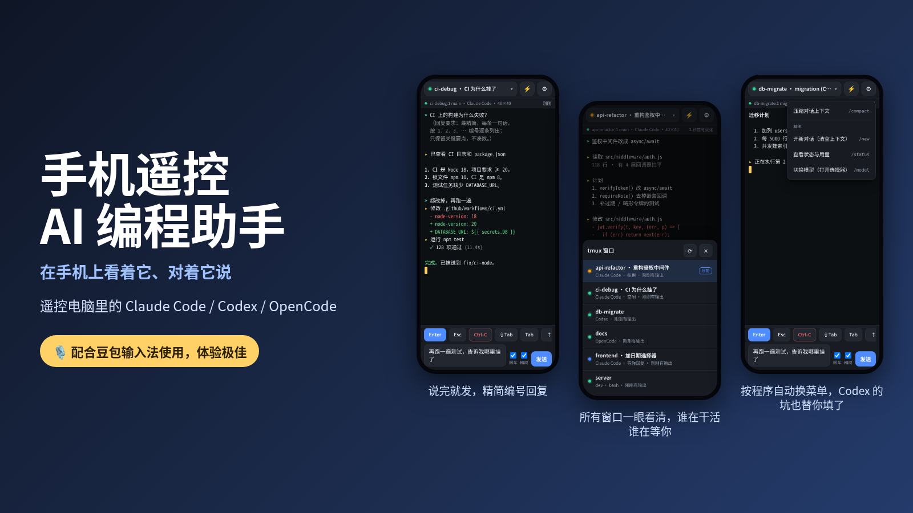
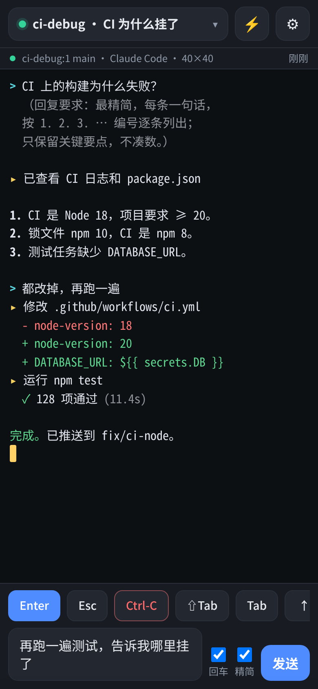
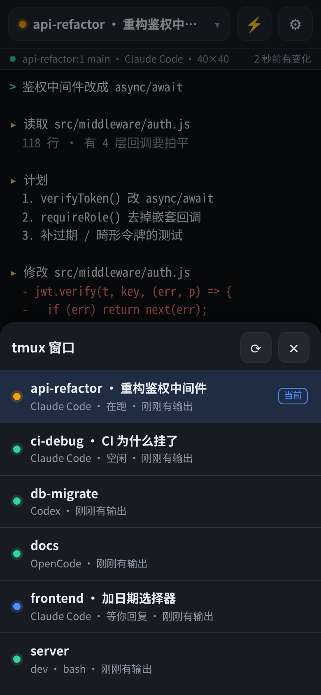
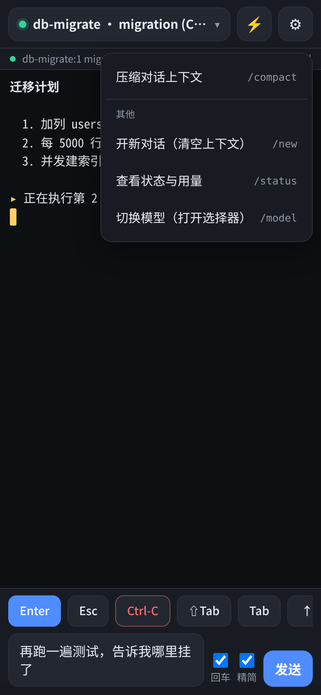

<div align="center">



# 手机遥控 AI 编程助手

<sub>Phone Remote for AI Coding Agents</sub>

### 在手机上看着它、对着它说——动嘴就能指挥电脑里的 AI 编程助手

支持跑在 tmux 里的 **Claude Code**、**Codex**、**OpenCode**，在手机浏览器里就能用。<br>
说完就发，回复精简成编号清单。**零依赖。**

    

[English](README.md) · **简体中文**

</div>

---

> ### 🎙️ 配合豆包输入法使用，体验极佳
>
> 它特意做成"一个文本框"：语音识别交给手机键盘去做，所以任何语音输入法都能用——作者每天用的就是 **豆包输入法**。
> 点输入框 → 点豆包的麦克风 → 说出你要做的事 → 扫一眼文字 → **发送**。整个流程就是这样，用起来很顺。
> [详细说明和小技巧 →](docs/voice-input.md)

## 为什么做它

你在 tmux 里让 AI 编程助手跑一个长任务——重构、"改到测试全绿"的循环、数据迁移——然后你得离开工位。助手一直在干活，然后停下来问你 *"要继续吗？"*，一等就是几个小时，因为你正在排队买咖啡。

它把那个窗口搬到你的手机上：看它在做什么，回答它的问题，下达下一条指令——可以直接用语音——不用 SSH App，不用在手机上敲小小的终端键盘，也不用注册任何云账号。

## 亮点

- 🎙️ **语音优先。** 输入框就是为"说"设计的：输入法组词时回车不会误发送，一点就发，一个勾就让回复变短。见 [豆包输入法](#-配合豆包输入法使用体验极佳)。
- 🤖 **认得出对面是谁。** 按进程树识别每个窗口里跑的是 Claude Code、Codex 还是 OpenCode——不看窗口名，因为窗口里跑什么一天会换好几次。标签、快捷菜单，以及最关键的 *怎么把字发进去* 都跟着程序走。（Codex 会吞掉"快速输入后紧跟的第一个回车"，这里已经替你绕开了。[为什么](docs/how-it-works.md#why-each-agent-gets-its-own-way-of-being-typed-to)）
- ✂️ **精简模式。** 一个勾，发出去的每条提示词后面自动追加一句话，要求助手用最短的编号清单回复。手机屏幕小，耐心也小。这句话的措辞是 [拿真实模型 A/B 测过的](#精简模式)。
- 🪶 **零依赖。** 只要 Node.js 和 tmux。没有 xterm.js、没有 node-pty、不用构建、没有中转服务器、不用注册。大约 2400 行代码，一个下午能读完。
- 🌍 **10 种界面语言**——English、简体中文、繁體中文、日本語、한국어、Español、Français、Deutsch、Português、Русский。加一种语言只需要[一个 JSON 文件](src/web/locales/README.md)。
- 🔒 **默认就是锁住的。** 随机访问令牌、只放行私有网络的来源 IP 白名单、没有云、没有遥测。[安全说明](docs/security.md)。
- 📶 **为不稳定的手机网络而写。** 屏幕没变化时只回 44 字节，大一点的回复会 gzip（页面从 66 KB 压到 20 KB），手机休眠醒来后请求会超时并自动恢复，不会卡死。
- 📜 **看得到之前的对话。** 跑在终端备用屏幕里的助手没有回滚历史；对 Claude Code，上拉就能从它自己的会话记录里把之前的对话加载出来。

<table>
  <tr>
    <td width="33%"></td>
    <td width="33%"></td>
    <td width="33%"></td>
  </tr>
  <tr>
    <td align="center"><sub>输入框里是刚语音说完、等着发送的一句话；上面的回答是精简后的编号清单</sub></td>
    <td align="center"><sub>每个 tmux 窗口：什么程序、在跑 / 等你回复 / 空闲</sub></td>
    <td align="center"><sub>⚡ 菜单随程序变化（这是 Codex 窗口）</sub></td>
  </tr>
</table>

<sub>截图用的是演示环境（用替身进程打印预先写好的文字），由 [`scripts/make-screenshots.mjs`](scripts/make-screenshots.mjs) 生成。</sub>

## 快速开始

在跑助手的那台电脑上需要 **Node.js 18+** 和 **tmux 3.x**。作者在 Linux 上开发和测试；macOS 理论上能用（进程识别会退回 `ps`），但作者没试过，欢迎反馈。 **Windows** 请在 WSL2 里运行（Windows 本身没有 tmux）：[分步说明](docs/windows.md)。

```bash
git clone https://github.com/unnamedfish2017/phone-remote-for-ai-coding-agents.git
cd phone-remote-for-ai-coding-agents
node bin/phone-remote.mjs
```

它会打印一个链接和一个二维码，**用手机扫码**即可——手机和电脑在同一个 Wi-Fi，或者走 [Tailscale](https://tailscale.com)、ZeroTier、WireGuard、公司 VPN 之类（它会列出手机可能用到的所有地址，并标出 VPN 那条）。二维码在终端够大时会自动放大一倍（`--qr-size`）；第一次在桌面系统上运行时，还会在浏览器里弹出一个整页的大二维码（`--open` 可随时再弹）。

```text
  Phone Remote for AI Coding Agents 0.1.0
  tmux 3.2a

  Open on your phone:

    http://192.168.1.23:8787/?token=…&lang=zh-CN
      ↳ Wi-Fi / LAN · wlan0
    http://100.101.102.103:8787/?token=…&lang=zh-CN
      ↳ VPN · tailscale0

  Scan this with your phone's camera (Wi-Fi / LAN · wlan0):

      █▀▀▀▀▀█ ▄█ ▄▄█▄▄█▀▀▀█ ▄▀▄ █▀▀▀▀▀█
      █ ███ █ ▄█▀█ ▄▄█ ▄▀█ ▀█   █ ███ █
      █ ▀▀▀ █ ▄ █ ▀▄▄▄▀▀▀▀▀  ▀  █ ▀▀▀ █
      ▀▀▀▀▀▀▀ ▀ ▀ █ █▄█ ▀▄▀▄█▄▀ ▀▀▀▀▀▀▀
      ███▀█ ▀▀██▀ ▀█▄ ▄█▄█▄▄▀█▄█▄█ ▀ █▄
    ⋮  （这里是完整的二维码）
```

照常在 tmux 里启动助手（`tmux new -s api`，然后运行 `claude`、`codex` 或 `opencode`）；每个 tmux 窗口都会出现在列表里。想要一个 `phone-remote` 命令？在目录里运行 `npm link`。

<details>
<summary><b>命令行选项</b>（<code>phone-remote --help</code> 看全部）</summary>

| 选项 | |
|---|---|
| `--port <n>` | 端口（默认 `8787`；`0` = 自动选一个空闲端口） |
| `--host <地址>` | 绑定地址（默认 `0.0.0.0`） |
| `--token <令牌>` | 用指定令牌代替自动生成的（`PHONE_REMOTE_TOKEN`） |
| `--allow-from <列表>` | 允许谁连接：CIDR / IP；默认 = 本机 + 私有网络 + Tailscale 网段 |
| `--cert` / `--key` | 启用 HTTPS（[怎么做](docs/security.md#https)） |
| `--lang <代码>` | 打印的链接里带的界面语言（默认取自系统语言环境） |
| `--public-url <地址>` | 手机应该使用的地址（当它不是本机某个网卡的地址时） |
| `--qr-size <大小>` | 二维码大小：`auto`（默认，终端够大时放大一倍）、`large`、`compact` |
| `--open` / `--no-open` | 在浏览器里打开一个整页大二维码（默认：第一次在桌面系统上运行时打开；SSH 下从不打开） |
| `--socket-name` / `--socket-path` | 连非默认的 tmux 服务器 |
| `--no-auth` | 完全不要令牌——只允许绑定在回环地址上 |

</details>

## 🎙️ 配合豆包输入法使用，体验极佳

把助手装进手机，意义就在语音：没人想在玻璃键盘上敲一大段话。

所以它**不做**语音识别。页面只是一个处理好了输入法细节的文本框，由键盘自带的语音输入来填它。作者每天用的是 **豆包输入法**：

1. 在手机上安装豆包输入法，并切换为当前键盘。
2. 打开页面，点输入框。
3. 点键盘上的 🎙️ 麦克风，说出你想让助手做的事。
4. 扫一眼识别出的文字（有错字就改一下），点 **发送**。

为什么这么搭：

- **不需要麦克风权限，也不需要 HTTPS。** 页面根本不碰麦克风——是键盘在听。局域网或 VPN 里用普通 HTTP 就够了。
- **对输入法友好。** 输入法组词期间回车会被忽略，所以确认语音识别的文字不会把半句话发出去。
- **精简模式**把冗长啰嗦的口语提示词，变成你一眼就能读完的编号清单。
- **短回复照常工作。** 对确认框回一个 `1`，发出去的就是 `1`——精简模式绝不会往菜单答复、斜杠命令、shell 命令后面追加东西。

其他语音输入法（讯飞、搜狗、Gboard、iOS 听写……）用起来一样。更多见 [docs/voice-input.md](docs/voice-input.md)。

## 支持的程序

| 程序 | 能识别 | 为它做了什么 |
|---|---|---|
| **Claude Code** | ✅ | 窗口列表里显示 在跑 / 等你回复 / 空闲、查看之前的对话（上拉）、`/btw` 顺便问一句、模型快捷切换 |
| **Codex** | ✅ | 用 Codex 一次就接受的方式发送回车（见下文）、`/status`、`/model` |
| **OpenCode** | ✅ | `/status`、`/models` |
| 其他任何程序 | – | 当作普通终端窗口使用 |

测试环境：Claude Code 2.1.284、Codex 0.163.0、OpenCode 1.18.33、tmux 3.2a，Node.js 18、20、22。要支持新程序，在 [`src/agents.mjs`](src/agents.mjs) 里加几行即可。

## 精简模式

**回车** 勾选框旁边有个 **精简** 勾选框，默认打勾。勾上之后，发出去的内容后面会自动追加这样一句话：

> *（回复要求：最精简，每条一句话，按 1. 2. 3. … 编号逐条列出；只保留关键要点，有几点列几条，不凑数、不求全。）*

它只在有用的地方追加：斜杠命令、`!` 开头的 shell 命令、`#` 开头的记忆指令、`1` / `y` 这类单字符答复、以及不是 Claude Code / Codex / OpenCode 的窗口（普通 shell 里追加会把命令改坏）都不会加。这句话有每种界面语言的版本，也可以在设置里改。

这句话的措辞不是凭感觉定的。拿 Claude Haiku 4.5 和 Sonnet 5.5，在 8～11 个日常问题上测过（样本小、每格只跑一次，但两个模型、两轮测试的规律一致）：

| 措辞 | 恰好回 4 条的比例 | 回复长度 |
|---|---|---|
| "按 1、2、3、4 编号" | 11 题里 7～8 题（连是非题也凑 4 条） | 基准 |
| "条数不固定" | 8 题里 0～1 题 | 长约 30% |
| **每条一句话 · 只留关键要点 · 不凑数 · 不求全**（现用） | 11 题里 1～3 题（是非题只回 1 条） | 持平或更短 |

把"1、2、3、4"写出来，模型就会把每个回答都凑成或砍成四条。更多见 [src/web/locales/README.md](src/web/locales/README.md)。

## 界面语言

English · 简体中文 · 繁體中文 · 日本語 · 한국어 · Español · Français · Deutsch · Português · Русский

在 **⚙ → 🌐 Language** 里选，或者选"自动"跟随手机语言。它打印的链接已经带上了你电脑的语言。加一种语言 = 在 [`src/web/locales/`](src/web/locales/) 里放一个 JSON 文件，见[指南](src/web/locales/README.md)；少了什么，测试会告诉你。

## 安全——请务必读一下

能连上这个服务的人就能往你的终端里打字，也就等于能以你的身份执行命令。所以：

- 每个 API 调用都需要随机生成的 **访问令牌**（只认请求头——放在网址里会留在日志和浏览器历史里）。首次启动时生成，保存在 `~/.phone-remote/token`（权限 `0600`）。
- 先查 **来源 IP 白名单**：默认只放行本机、私有网络（`10/8`、`172.16/12`、`192.168/16`）和 Tailscale 的 `100.64/10`。就算你的机器有公网地址，陌生人也会在尝试令牌之前就被拒绝。
- 不要令牌的模式（`--no-auth`）只允许绑定在回环地址上，并且会拒绝带着陌生 `Host` 名字的请求（防 DNS 重绑定）。
- 写操作必须是 JSON，所以你随手打开的网页没法往它 POST。
- 在可信的局域网或加密 VPN（Tailscale、WireGuard）里，普通 HTTP 就可以。其他情况请[用 HTTPS](docs/security.md#https)。

**不要把它暴露到公网。** 把令牌当 SSH 密钥对待。细节见 [docs/security.md](docs/security.md)。

## 原理

```text
  手机浏览器   ⇄   本服务（一个 Node 进程）   ⇄   tmux   ⇄   Claude Code / Codex / OpenCode
  文本框、按键条、    页面每 350 ms 轮询一次，          capture-pane  → 屏幕（颜色是 SGR 序列）
  快捷菜单            服务每次去问 tmux；               send-keys     → 打字
                      屏幕没变就只回 44 字节            paste-buffer  → 多行文本
```

没有 pty、没有终端模拟器、没有 WebSocket：屏幕就是 `tmux capture-pane -e`，几十行 JavaScript 把颜色码变成 HTML，输入再通过 `send-keys` 送回去。所以它很小——也所以它能配合任何跑在 tmux 窗口里的东西。[详细版 →](docs/how-it-works.md)

## 常见问题

| 现象 | 试试 |
|---|---|
| 手机打不开链接 | 手机和电脑在同一网络或 VPN 里吗？防火墙放行端口了吗（`sudo ufw allow 8787/tcp`）？手机要用别的地址就加 `--public-url`。 |
| `403` / "你的 IP 地址不被允许" | 手机地址不在默认白名单里——加上：`--allow-from 192.168.0.0/16,203.0.113.0/24`。 |
| 页面能打开，但走 VPN 或移动数据时"请求超时" | 多半是路径 MTU 黑洞。[诊断方法和一行修复](docs/troubleshooting.md#requests-time-out-over-a-vpn-or-mobile-data-but-small-things-work)。 |
| 少了一个窗口 | 它连的是 tmux 默认服务器。要连别的：`--socket-name` / `--socket-path`。 |
| Codex 要按两次回车 | 本不该发生（已处理）。如果发生了，说明没认出那个程序（比如它跑在 `ssh` 里）：在 `~/.codex/config.toml` 里设 `disable_paste_burst = true`。 |

更多见 [docs/troubleshooting.md](docs/troubleshooting.md)。

## 同类项目

本项目特意不做终端模拟器。如果你想要浏览器里的完整终端，带鼠标和深度回滚，这些都不错：[tmux-webui](https://github.com/operonlab/tmux-webui)、[mobux](https://docs.rs/crate/mobux)、[Muxile](https://github.com/bjesus/muxile)。想用聊天软件遥控助手，有 [CCGram](https://github.com/OmidS/ccgram)（Telegram）。它的定位：很小、零依赖、认得出对面是哪个助手、围绕语音输入来设计。

## 参与贡献

欢迎提 bug、加新语言、加新程序的适配——见 [CONTRIBUTING.md](CONTRIBUTING.md)。`npm test` 会跑 60 多个测试（需要 tmux，不需要联网）。

## 社区

- [Linux.Do](https://linux.do/) — 与社区一起分享、讨论、关注开发进展。

## 许可证

[MIT](LICENSE)
